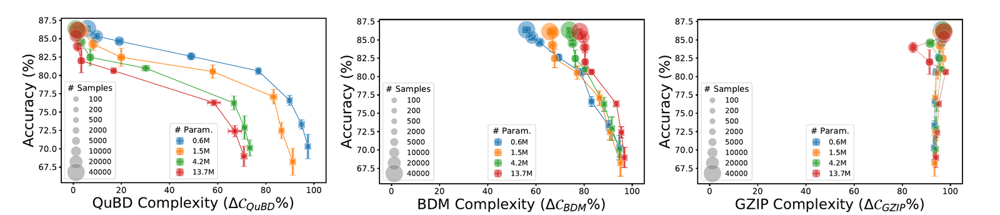

Authors: Pedram Bakhtiarifard, Sophia N. Wilson, Mahmoud H. A. Afifi, Jonathan Wenshøj, Raghavendra Selvan 
University of Copenhagen and The American University in Cairo

The Climate AI Nordics featured paper for November 2026 is [_Characterizing Learning in Deep Neural Networks using Tractable Algorithmic Complexity Analysis_](https://arxiv.org/abs/2605.15551),
which will be presented at [NeurIPS 2026](https://neurips.cc/) in December. The work comes from the [SAINTS Lab](https://saintslab.github.io/) at the University of Copenhagen.

Training large deep learning models is typically energy-intensive and often has a considerable environmental footprint. A common remedy is to compress trained models, i.e. pruning away most
of their weights, or quantizing them down to just a few bits -- often with only small drops in performance. But _why_ can modern neural networks be compressed so drastically in the first place?

A widely held hypothesis is that "learning is compression": training builds structure into the network weights, and this structure is what makes compression possible. A natural way to
measure such structure is algorithmic complexity (Kolmogorov-Chaitin-Solomonoff complexity), roughly the length of the shortest program that can generate an object. Structured objects
have short descriptions, while random ones do not. However, existing estimators only work for small binary objects and do not scale to the millions or billions of parameters in modern networks.

The paper introduces the **Quantized Block Decomposition method (QuBD)**, shown in the figure above. QuBD first quantizes the network weights to a finite set of values, then splits them into
bit-planes and adds up the estimated complexity of each plane. The authors show theoretically that this gives a tighter estimate than earlier approaches that binarize the weights.

Using QuBD, the paper shows that:

- **Algorithmic complexity decreases as networks learn**, and decreases more with more training data. For the largest network studied, it drops to about 5% of its value at initialization.
- **Complexity tracks generalization:** it increases again when a network starts to overfit, and it follows the delayed generalization seen during "grokking".
- The trend holds across **100 pretrained models** with up to 100 million parameters, and for a **1-billion-parameter language model** (Pythia-1B).
- **Useful information sits in the most significant bit-planes.** The lower bit-planes look close to random, which matches how far models can be quantized after training without losing accuracy. QuBD can therefore serve as a practical diagnostic for choosing quantization levels, or which layers to prune.

_Figure 4 from the paper: as networks of different sizes (colours) are trained on more data (larger circles), their accuracy improves while their QuBD complexity drops (left). Earlier measures, BDM (center) and GZIP compression (right), do not capture this connection._

**Why it matters for climate and the environment:** Compression is one of the main tools for making AI models cheaper and less energy-hungry to run. Understanding _why_ and _how much_
a model can be compressed, rather than finding out by trial and error, can help build leaner models from the start and reduce the environmental footprint of AI (at least if disregarding
potential rebound effects).

For more details, explore:
- [Paper (arXiv)](https://arxiv.org/abs/2605.15551)
- [Code](https://github.com/saintslab/QuBD)
